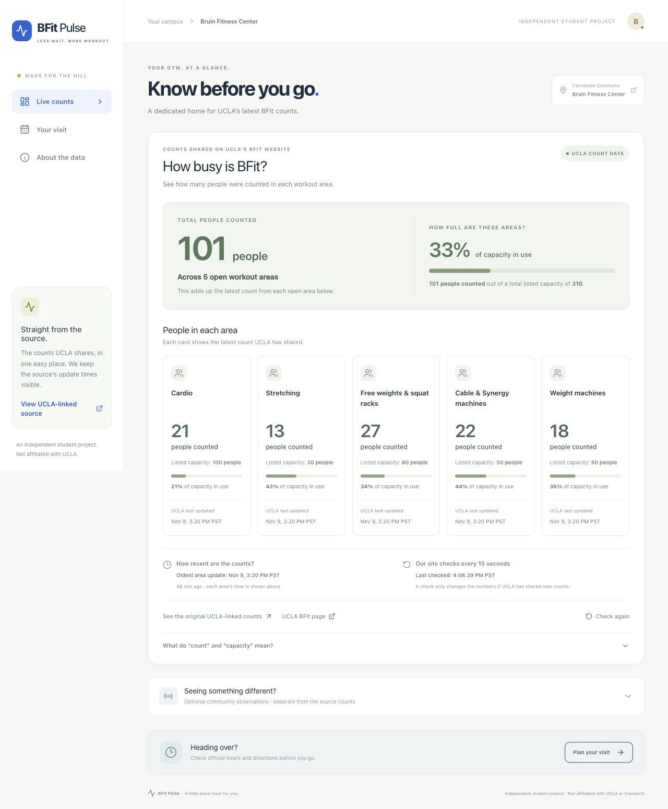
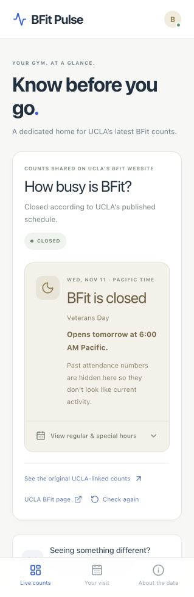
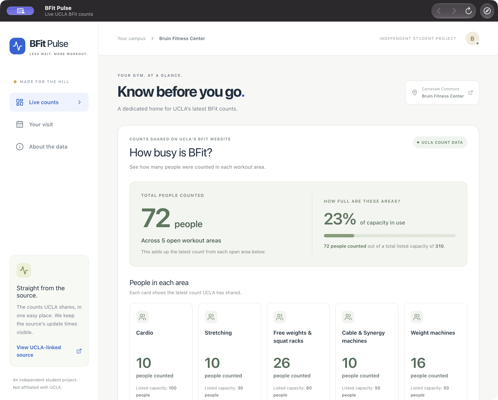

# BFit Pulse

**Know before you go.** A dedicated web dashboard and Mac app for UCLA's Bruin Fitness Center (BFit).

[Live website](https://bfit-pulse.atomicmacaron2.chatgpt.site) · [Mac download](https://github.com/adhitn/bfit-pulse/raw/refs/heads/main/downloads/BFit-Pulse-Mac.dmg) · [Developer guide](web/README.md) · [UCLA pilot proposal](docs/UCLA-PILOT-PROPOSAL.md)

[](https://github.com/adhitn/bfit-pulse/actions/workflows/checks.yml)

## Why I built it

Students need a quick way to decide whether to head to the gym. UCLA already publishes BFit zone counts, but those figures sit inside a facility page and can be difficult to interpret at a glance. BFit Pulse puts the latest reported crowd levels, their update times, and the gym's opening hours in one mobile-friendly view.

Project by **Adhit Natla**, developed with AI assistance. Independent student project; not affiliated with or endorsed by UCLA, Connect2, NOM, or OpenAI.

## What it does

- Reads the same public Connect2 feed linked by UCLA Recreation; no invented attendance values.
- Shows counts and capacity percentages for five BFit workout areas, with plain-language labels.
- Checks for count updates every 15 seconds while the open-gym view is visible, with a shared 15-second server cache.
- Shows Pacific-time opening hours, early closings, and confirmed holiday closures.
- Hides old attendance numbers when closed and waits for a fresh count after reopening.
- Labels stale data, source failures, and unconfirmed hours explicitly.
- Keeps optional signed-in community observations separate from official source counts.
- Offers a native Swift Mac app with its own window, Dock icon, reload controls, and connection error screen.

## Preview

Screenshots show the prototype at the time they were captured; attendance values are historical examples from the real feed.



<details>
<summary>Closed-hours display and native Mac app</summary>





</details>

## Technology

| Part | Tools |
| --- | --- |
| Web interface | React 19, TypeScript, CSS, Lucide icons |
| Framework and build | Vinext, Vite, Node.js |
| Server and storage | Cloudflare Workers, D1/SQLite, Drizzle |
| Mac app | Swift, AppKit, WKWebView; universal Apple silicon + Intel build |
| Testing | Node's test runner, TypeScript checks, production build |
| Hosting | Sites / Cloudflare; public website linked above |

## Repository guide

```text
bfit-pulse/
├── web/                     Website source, API routes, database migrations, tests
├── macos/                   Swift app source, icon generator, build script
├── docs/
│   ├── ARCHITECTURE.md      Data flow, freshness, hours, and design decisions
│   ├── DEVELOPMENT.md       Editing, validation, Git, and publishing
│   ├── UCLA-PILOT-PROPOSAL.md
│   └── screenshots/
├── downloads/               Built Mac app in DMG and ZIP formats
└── .github/workflows/       Automatic web checks and Mac build
```

## Run the website locally

Install Node.js 24 and Git, then:

```sh
git clone https://github.com/adhitn/bfit-pulse.git
cd bfit-pulse/web
npm ci
npm run build
```

Initialize the local database once on a fresh clone:

```sh
node --import ./scripts/sites-env.mjs ./node_modules/wrangler/bin/wrangler.js d1 execute DB --local --config dist/server/wrangler.json --persist-to .wrangler/state --file drizzle/0000_daffy_thunderbolts.sql
node --import ./scripts/sites-env.mjs ./node_modules/wrangler/bin/wrangler.js d1 execute DB --local --config dist/server/wrangler.json --persist-to .wrangler/state --file drizzle/0001_watery_lilandra.sql
npm run dev
```

Open the local URL printed by the server, normally `http://localhost:5173`. The local database is separate from production. No private UCLA API key is required. See the [web developer guide](web/README.md) for configuration and report sign-in details.

## Use or build the Mac app

[Download the DMG](https://github.com/adhitn/bfit-pulse/raw/refs/heads/main/downloads/BFit-Pulse-Mac.dmg) or [ZIP](https://github.com/adhitn/bfit-pulse/raw/refs/heads/main/downloads/BFit-Pulse-Mac.zip). The app needs macOS 13+ and an internet connection. It loads the same hosted website, so website improvements appear without rebuilding the app.

The current build has a local ad hoc signature and is not Apple-notarized. A normal publicly verified distribution would require Developer ID signing and notarization. The project does not disable macOS security checks.

To rebuild using Xcode or compatible Command Line Tools:

```sh
cd macos
bash build.sh
```

See [Mac app instructions](macos/README.md) for shortcuts, editing, and distribution details.

## Check changes

```sh
cd web
node --test tests/*.test.mjs
node node_modules/typescript/bin/tsc --noEmit
npm run build
```

The initial test suite contains 28 tests covering feed validation, Pacific timestamps, freshness, network recovery, operating hours, midnight boundaries, holidays, conflicting source dates, and suppression of old attendance. GitHub Actions runs the web checks and builds the universal Mac app on pushes and pull requests.

## Data sources and limits

- **Counts:** the public Connect2 widget linked on [UCLA's BFit page](https://recreation.ucla.edu/facilities/bfit). Refreshing this app cannot make UCLA staff update the underlying counts faster.
- **Hours:** the same official BFit page, with server caching and a reviewed Fall 2026 fallback. Ambiguous dates and periods beyond the reviewed schedule require confirmation.
- **Meaning:** totals sum reported zone counts; they are not a deduplicated building headcount or an official safety limit.
- **Privacy:** optional observations do not publish names or collect GPS traces. Databases, private credentials, caches, and local environment files are excluded from this repository.

The current hours parser deliberately requires review for a new season or source format. See [architecture and current limitations](docs/ARCHITECTURE.md) before extending it or proposing an official campus launch.

## Continuing the project

Open this repository in VS Code, Cursor, or your preferred editor. Start with `web/app/pulse-app.tsx` for page content, `web/app/globals.css` for appearance, or `macos/Source/Main.swift` for native app behavior. The [development guide](docs/DEVELOPMENT.md) explains the rest.

GitHub stores and shares the source. A push does **not** automatically publish the live website; deployment remains a separate step through its existing hosting project.
