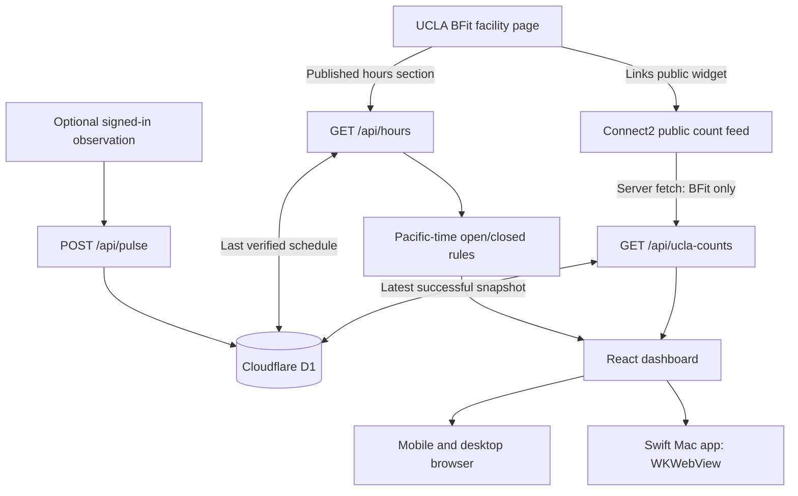

# How BFit Pulse works

## Data flow

## Official counts

`web/lib/ucla-counts.ts` normalizes the public Connect2 feed to FacilityId 803 and validates zone IDs, count values, capacities, and source timestamps. The public widget URL contains a browser-visible account key; it is a public feed identifier, not a private account credential.

The count endpoint uses a 15-second shared D1 cache. The browser checks every 15 seconds while visible and open, and checks again on focus. Ordinary provider changes generally appear within roughly 30 seconds plus network delay. This is polling, with no push subscription or guarantee about when source staff record counts.

Source timestamps and app check times are separate. The source omits a time zone, so the app interprets its times as `America/Los_Angeles` and explains that assumption. Data over 60 minutes old is labeled stale. Failures can show the last successful snapshot with its original timestamp and a warning; no generated or demonstration values replace missing data.

Server requests own their I/O. In-flight fetch promises are never shared across visitor requests. Fetch and response-body reads have deadlines, with bounded database access, so stalled requests can recover on later checks.

## Operating hours take priority

`web/lib/bfit-hours.ts` parses the official Hours section, applies explicit dated exceptions, and calculates current availability using Pacific time. The server caches hours for 15 minutes, the browser checks every five minutes and on focus, and a local clock handles opening/closing boundaries without waiting for an attendance refresh.

The attendance display follows this order:

1. Closed by the published schedule: hide attendance and show the next confirmed opening.
2. Hours unknown or conflicting: request confirmation and hide attendance.
3. Open, but the source count predates this opening period: wait for a new count.
4. A fresh source snapshot marks all areas closed: show the source's closure state.
5. Otherwise: show the reported numbers with their freshness labels.

The reviewed fallback is Fall 2026. Ordinary weekly hours are bounded to December 11, 2026, the reviewed fall-term end; later dates are unknown rather than automatically closed. Dated exceptions are retained with their explicit year. The parser rejects an unreviewed season or unsupported source format, preventing old holiday rules from silently recurring forever.

UCLA's source currently labels a Thanksgiving Sunday as `11/28`, a Saturday in 2026, while explicitly closing Saturday. The app keeps the confirmed Saturday closure and flags the nearby Sunday for confirmation rather than moving the listed opening time to a guessed date.

## Optional community observations

The observation feature is secondary. It requires Sites sign-in, an on-site confirmation, and a server-enforced one-minute cooldown. Affiliation and location are not independently verified. Reports expire from display after 30 minutes and are pruned after 24 hours on the next successful write. Public responses omit user IDs. Observations never overwrite the official feed.

## Native Mac app

The Swift app in `macos/` wraps the hosted site in WKWebView. External links open in the system browser. Browser sign-in stays in the browser; its cookies are not copied into the app. The app has no separate gym database or offline count feed.

`macos/build.sh` compiles arm64 and x86_64 binaries, combines them, generates a native icon, and applies an ad hoc signature. Website changes require a reload, not a new binary. Changing the URL, toolbar, or other native behavior requires rebuilding. Developer ID signing and Apple notarization remain future distribution work.

## Sources and validation

- [UCLA BFit facility page and hours](https://recreation.ucla.edu/facilities/bfit)
- [UCLA Recreation member services](https://recreation.ucla.edu/member-services)
- [UCLA annual academic calendar](https://registrar.ucla.edu/calendars/annual-academic-calendar)
- A captured official hours fixture and source lines are preserved in `web/tests/fixtures/` and `web/data/` for reproducible parser tests.

The suite covers count normalization, invalid source rows, Pacific DST offsets, timestamp validity, stale/future updates, timed-out connections and body reads, cache timeouts, midnight, weekday/weekend boundaries, holiday overrides, overnight hours, source conflicts and corrections, and pre-opening attendance suppression.

## Before an official campus launch

The [pilot proposal](UCLA-PILOT-PROPOSAL.md) describes a possible review with UCLA. Source semantics, provider expectations, timestamp interpretation, usability, accessibility, moderation, and branding would need agreement. This repository represents an independent working prototype, with no UCLA partnership or approval claimed.
